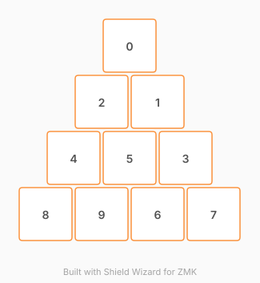

# ZMK Configuration for pax

*Generated by Shield Wizard for ZMK*



Download compiled firmware from the Actions tab. <https://zmk.dev/docs/user-setup#installing-the-firmware>

Edit your keymap <https://zmk.dev/docs/keymaps>.
User keymap is located at [`config/pax.keymap`](config/pax.keymap).

-----

<details>
<summary>
Shield Wizard Debug Information
</summary>

In case of broken configuration, here is the Shield Wizard internal data used to generate this configuration:

Commit: 84a348b08cf4fec4a5441a46147e9a345b10ffab

```json
{"name":"pax","shield":"pax","dongle":false,"modules":[],"layout":[{"id":"01M562RPRPCW16VQDCRE6DJ8DH","part":0,"row":0,"col":0,"w":1,"h":1,"x":1.5,"y":0,"r":0,"rx":0,"ry":0},{"id":"01M562RPRP5Y3E8C2GF2WB93Q0","part":0,"row":1,"col":1,"w":1,"h":1,"x":2,"y":1,"r":0,"rx":0,"ry":0},{"id":"01M562RPRPT5FDSK4TXY9Q6AK9","part":0,"row":1,"col":0,"w":1,"h":1,"x":1,"y":1,"r":0,"rx":0,"ry":0},{"id":"01M562RPRNZNPSND6MB8RRBESV","part":0,"row":2,"col":2,"w":1,"h":1,"x":2.5,"y":2,"r":0,"rx":0,"ry":0},{"id":"01M562RPRNBSHY0AXDT9T8TDVN","part":0,"row":2,"col":0,"w":1,"h":1,"x":0.5,"y":2,"r":0,"rx":0,"ry":0},{"id":"01M562RPRN94W785YW1RTX1S9X","part":0,"row":2,"col":1,"w":1,"h":1,"x":1.5,"y":2,"r":0,"rx":0,"ry":0},{"id":"01M562RPRNT0T2XYY1EKAAXBE7","part":0,"row":3,"col":2,"w":1,"h":1,"x":2,"y":3,"r":0,"rx":0,"ry":0},{"id":"01M562RPRN6R81CGPJ1QNF32C5","part":0,"row":3,"col":3,"w":1,"h":1,"x":3,"y":3,"r":0,"rx":0,"ry":0},{"id":"01M562RPRNGTNCFMTW2SD71VHK","part":0,"row":3,"col":0,"w":1,"h":1,"x":0,"y":3,"r":0,"rx":0,"ry":0},{"id":"01M562RPRNCATJ8FBEV356NF38","part":0,"row":3,"col":1,"w":1,"h":1,"x":1,"y":3,"r":0,"rx":0,"ry":0}],"parts":[{"name":"unibody","controller":"nice_nano_v2","pins":{"d1":{"usage":"kscan","kscan":"01M562RXGTEB0K1HE3D01PZKVQ","role":"input"},"d0":{"usage":"kscan","kscan":"01M562RXGTEB0K1HE3D01PZKVQ","role":"input"},"d2":{"usage":"kscan","kscan":"01M562RXGTEB0K1HE3D01PZKVQ","role":"input"},"d3":{"usage":"kscan","kscan":"01M562RXGTEB0K1HE3D01PZKVQ","role":"input"},"d4":{"usage":"kscan","kscan":"01M562RXGTEB0K1HE3D01PZKVQ","role":"input"},"d5":{"usage":"kscan","kscan":"01M562RXGTEB0K1HE3D01PZKVQ","role":"input"},"d6":{"usage":"kscan","kscan":"01M562RXGTEB0K1HE3D01PZKVQ","role":"input"},"d7":{"usage":"kscan","kscan":"01M562RXGTEB0K1HE3D01PZKVQ","role":"input"},"d8":{"usage":"kscan","kscan":"01M562RXGTEB0K1HE3D01PZKVQ","role":"input"},"d9":{"usage":"kscan","kscan":"01M562RXGTEB0K1HE3D01PZKVQ","role":"input"}},"kscans":[{"kind":"direct","id":"01M562RXGTEB0K1HE3D01PZKVQ","mode":"gnd"}],"keys":{"01M562RPRNGTNCFMTW2SD71VHK":{"input":"d1"},"01M562RPRNCATJ8FBEV356NF38":{"input":"d0"},"01M562RPRNT0T2XYY1EKAAXBE7":{"input":"d2"},"01M562RPRN6R81CGPJ1QNF32C5":{"input":"d3"},"01M562RPRNBSHY0AXDT9T8TDVN":{"input":"d4"},"01M562RPRN94W785YW1RTX1S9X":{"input":"d5"},"01M562RPRNZNPSND6MB8RRBESV":{"input":"d6"},"01M562RPRPT5FDSK4TXY9Q6AK9":{"input":"d7"},"01M562RPRP5Y3E8C2GF2WB93Q0":{"input":"d8"},"01M562RPRPCW16VQDCRE6DJ8DH":{"input":"d9"}},"encoders":[],"buses":{}}]}
```

</details>
